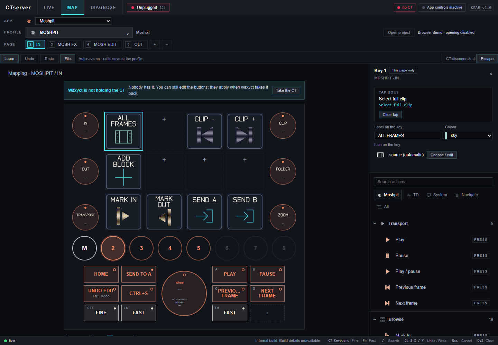
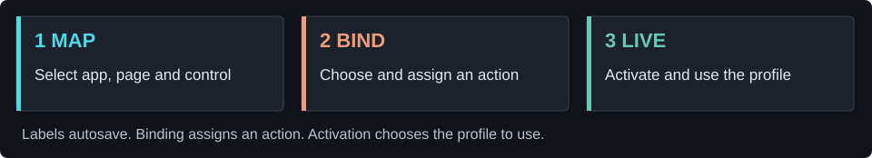
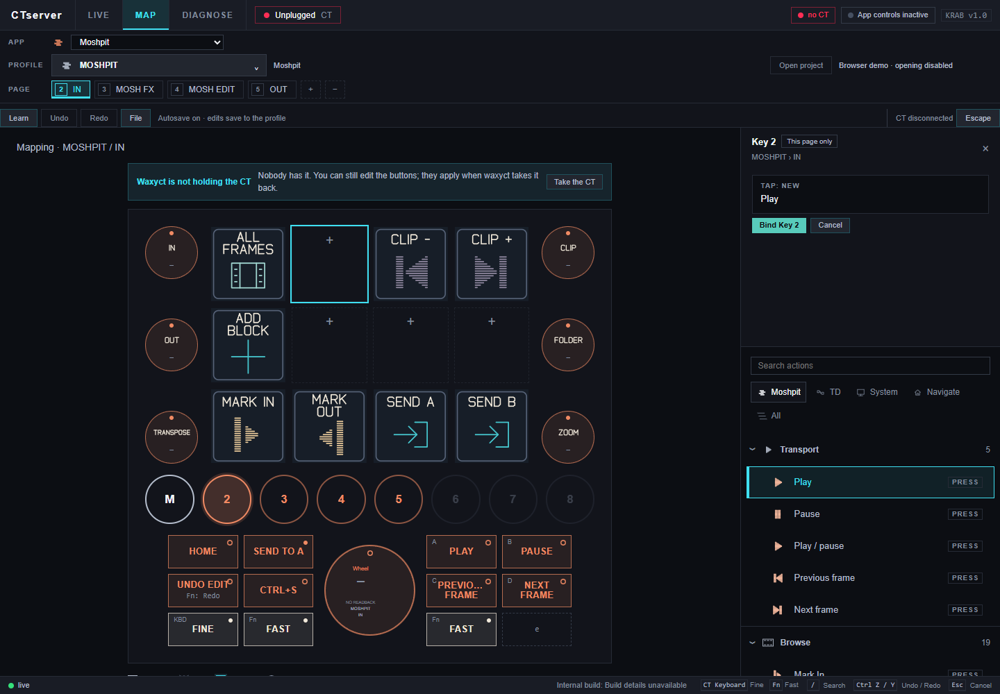

# CTserver

**Make a Loupedeck CT fit the way you work.**

Choose an app profile, map its keys and dials, and use the same labelled controls on the desktop and device. Includes generic starting profiles for Moshpit, Windows, Spotify and DaVinci Resolve.

[Get started](#get-ctserver) · [Map your first key](#map-your-first-key) · [Controls guide](docs/FIRST-MAPPING.md) · [Help](#when-something-goes-wrong) · [Developers](docs/DEVELOPMENT.md)

Actual public UI and generic Moshpit profile, captured in a disconnected browser demo. No hardware is connected in these screenshots; they illustrate editing, not a device-readiness test.

## Get CTserver

| What you want | Available today |
| --- | --- |
| Understand the app or plan a mapping | Read the walkthrough below. You can edit maps without a connected CT. |
| Download a Windows installer | **Not public yet.** Binary licence, clean-Windows and signing checks remain. [Release status](https://github.com/adrienwax/ctserver/releases). |
| Run the source | [Windows setup](docs/DEVELOPMENT.md#run-from-source): Git, Node.js 24, npm and compatible native dependencies. |
| Try a privately supplied candidate | Follow the [short first-use checklist](docs/TESTING.md). |

**“Code → Download ZIP” is source code, not an installer.** Windows x64 and **Loupedeck CT** are the current target. Other operating systems and Loupedeck models are not validated by this project.

CTserver is an independent project, not the official Loupedeck application. Run only one device owner at a time: quit another controller application normally before letting CTserver take the CT.

## Map your first key

This example adds a **Play** key to Moshpit’s IN page. You can do the editing part with the CT unplugged.

1. **Open MAP.** Choose **Moshpit** in **APP**, then **MOSHPIT** in **PROFILE** and the **IN** page.
2. **Click an empty square tile** on the controller picture. Key 2—the second tile in the top row—is empty in the supplied profile. The right-hand editor identifies the selected key and its scope.
3. **Choose Moshpit → Transport → Play** in the action library. Review **TAP: NEW**, then click **Bind Key 2**. Selecting an action is a draft until you bind it.
4. **Set “Label on the key” to PLAY**, then press Tab. Choose a colour or icon if you want. Wait for **Saved**. Label/appearance edits autosave; there is no separate Save Profile step.
5. **Try Undo, then Redo** in the toolbar. Confirm that the intended change returns. [Page-only versus shared mappings](docs/FIRST-MAPPING.md#pages-and-shared-controls) matters when you edit other controls.
6. **Use it when ready.** Open Moshpit, connect the CT, take ownership if needed and use **Activate on CT** for the selected profile. Check the app-control connection before pressing your new key. [Connection guide](docs/FIRST-MAPPING.md#connect-to-moshpit).

The binding is still a draft in this screenshot. Editing a map does not itself execute the chosen action.

## Three views, three jobs

| View | Purpose |
| --- | --- |
| **LIVE** | See and operate the active profile and its feedback. |
| **MAP** | Choose the app/profile/page, inspect a control, and edit its action or appearance. |
| **DIAGNOSE** | Inspect connection, ownership and app-link status when something is unavailable. |

An **app** is the target software. A **profile** is a set of controls for it. A **page** is one arrangement within that profile. Tiles, dial turns and dial presses can have different actions. [The illustrated controls guide](docs/FIRST-MAPPING.md) covers them without requiring hand-edited JSON.

## Saving, quitting and startup

- **Wait for Saved after editing.** Binding an action and activating a profile are separate operations.
- **Window X hides the desktop app.** Use its tray menu → **Quit CTserver** to exit and release the CT.
- **Startup is opt-in.** Cloning the repository or installing dependencies does not make CTserver start with Windows. [Paths, backups and startup](docs/DEVELOPMENT.md#settings-and-startup).
- Generic profiles provide actions, not the target applications or their project files. App focus, shortcuts and compatible control links affect what works. No private TouchDesigner rig is bundled.

## When something goes wrong

| Symptom | First check |
| --- | --- |
| Device blank / Unplugged / unavailable | USB, the previous device owner, then DIAGNOSE. Do not start a second CTserver to fix the first. |
| The app closed but CT is still held | X hides it; use the tray’s Quit action. |
| A key looks right but does nothing | Confirm the active profile/page, target app focus and app-control connection. |
| A label edit does not remain | Leave the field, wait for Saved, and check which configuration directory is in use. |
| A source build fails on a native module | Keep the error and Node/Electron versions; follow the separate bridge setup in the developer guide. |

[Report a bug](https://github.com/adrienwax/ctserver/issues) with the version, profile/page and steps. Remove private paths and tokens from attachments. Use [private security reporting](https://github.com/adrienwax/ctserver/security/advisories/new) for vulnerabilities.

## Go further

- [Keys, dials, pages and Moshpit connection](docs/FIRST-MAPPING.md)
- [First-use checklist](docs/TESTING.md) · [Source setup and repository map](docs/DEVELOPMENT.md)
- [Public release limitations](docs/RELEASE-STATUS.md) · [Moshpit](https://github.com/adrienwax/moshpit)

Original code is **MIT**, copyright 2026 **ak wax**. Retain the [dependency notices](THIRD-PARTY-NOTICES.txt), [asset notices](ASSET-NOTICES.txt) and [third-party licences](third-party). Third-party application names describe integrations, not endorsements. [Security policy](SECURITY.md).
