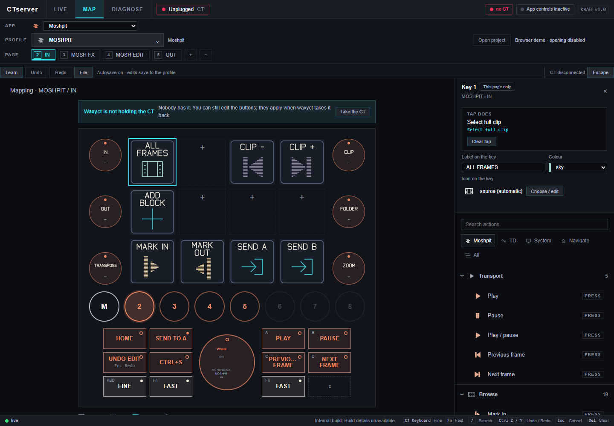
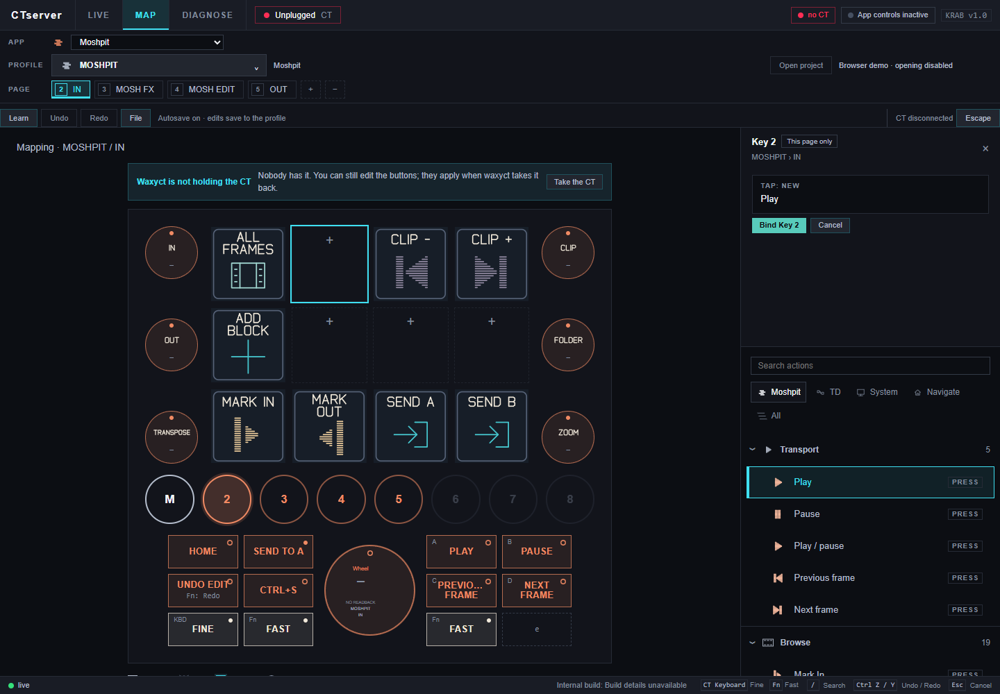
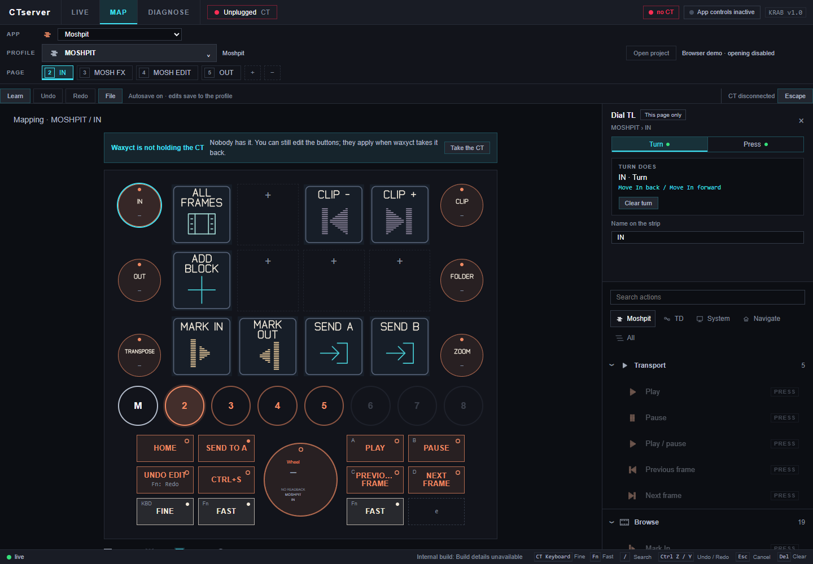

# Make a mapping you understand

[← CTserver](../README.md) · [Source setup](DEVELOPMENT.md) · [First-use check](TESTING.md)

**Goal:** assign a Play key, know when it is saved, and understand how the selected map reaches the CT. Editing does not require a connected device.

## 1 · Choose the context

Open **MAP → APP: Moshpit → PROFILE: MOSHPIT → PAGE: IN**. The app chooses a family of profiles; the profile chooses a complete control set; the page selects one arrangement.

Disconnected demonstration of the public UI and profiles. Hardware and app controls are intentionally inactive.

## 2 · Choose the physical control

Click the second square tile in the top row. In the supplied Moshpit IN page this is empty; the editor calls it **Key 2**. Check the title and **This page only** badge before editing.

The controller picture selects the thing you are configuring. It is not a list of actions. The action library is on the right, below the selected control’s details.

## 3 · Choose an action, then bind it

In the library, choose **Moshpit → Transport → Play**. The upper editor now says **TAP: NEW**. Press **Bind Key 2** to apply it, or **Cancel** to discard the draft.

This is deliberately separate from editing the label: a tile called PLAY does not become a Play action merely because of its name.

## 4 · Make the label readable

Set **Label on the key** to **PLAY** and press **Tab**. Choose an app colour or another colour from the adjacent picker. **Choose / edit** opens the icon library.

Wait for **Saved**. Label and appearance changes autosave after editing. Use the toolbar’s **Undo** and **Redo** to check or reverse a change; do not look for a second Save Profile command.

Icon artwork may be shared by more than one key. Choosing an icon is different from editing the artwork itself: editing shared artwork changes other keys using that icon too.

## 5 · Activate only when you want to use it

Quit any other CT owner normally, open the target app, and connect the device. If CTserver is not holding it, use **Take the CT**. Use **Activate on CT** to activate the selected profile.

Check the connection/status indicators. A saved map can exist while the CT is unplugged or the target app is unavailable; those conditions do not mean the map was lost. **LIVE** is the operating view; **DIAGNOSE** helps distinguish the connection states.

## Pages and shared controls

| Editor label / control | What it means |
| --- | --- |
| **This page only** | This mapping applies to the selected page. |
| **All pages / shared** | A shared mapping used across the profile’s pages. |
| **Edit this page only** | Create a page-specific override rather than change the shared mapping. |
| **Use shared mapping** | Remove the page override and use the profile’s shared mapping again. |
| **Dial turn / press** | Rotating a dial and pushing it can do different things. Choose the intended action slot. |
| **Fn + tap** | An alternate action for a supported button; it is not the ordinary tap binding. |

The Moshpit profile keeps **A: Play**, **B: Pause**, **C/D: previous/next frame**. **KBD** gives finer adjustments and **Fn** gives coarser adjustments where the mapped operation supports them. Profile pages follow IN, MOSH FX, MOSH EDIT and OUT.

## Connect to Moshpit

1. Run both apps as the same Windows user. Open Moshpit first.
2. CTserver reads Moshpit’s local `control-endpoint.json`; this includes a connection token, so keep it private.
3. The generic source profile expects `%APPDATA%/Moshpit 3/control-endpoint.json`. A separate **Moshpit KRAB Candidate** uses its own settings location instead. The `endpointFile` in your CT configuration’s `apps.json` must point at the instance you intend to control.
4. A running process name and a control endpoint are different settings. Configure verified local app paths only if you want launch/focus behaviour; opening an app normally does not require a project-launch tile.
5. If the link is inactive, check DIAGNOSE and the expected endpoint location. Do not paste the token into a public issue or hard-code a guessed port.

Windows/Resolve keyboard actions also depend on which app has focus and its shortcuts. Spotify uses its configured media integration. TouchDesigner needs a compatible project and matching profile; this repository does not provide the maintainer’s private rigs.

## Finish the session

Wait for **Saved**, then quit through the tray menu. Closing the window with X only hides it. [Configuration locations and backups](DEVELOPMENT.md#settings-and-startup) explain where your edits are stored.
